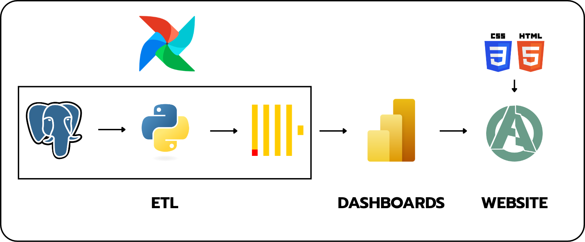
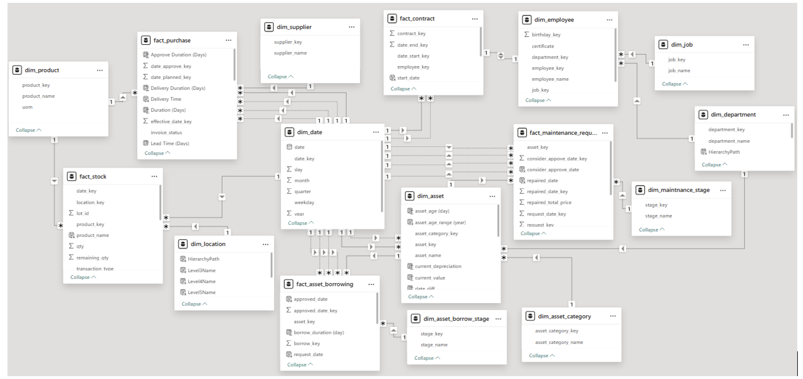
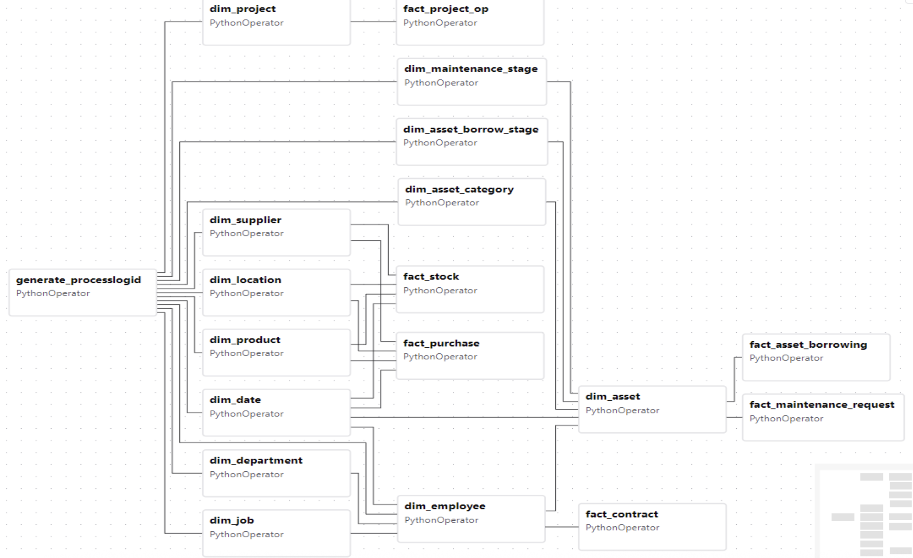

# Development of Executive Reporting Dashboards
- Developed an automated ETL pipeline project using Python, SQL, and Apache Airflow to extract operational data from Odoo ERP (PostgreSQL), transforming and loading it into ClickHouse.
- Designed a Dimensional Data Model in ClickHouse to structure transformed data, optimizing query performance for Dashboards. 
- Designed and embedded interactive Power BI dashboards into web pages based on user requirements.
- [Example of Dashboards Website](https://nattharat-s.github.io/internship_project/operation.html)

## Data Pipeline

## Dimensional Model

## Workflow Orchestration
DAGs in Apache Airflow run every 30 minutes. /n/
collect process log id > process Dimension tables > process Fact tables

